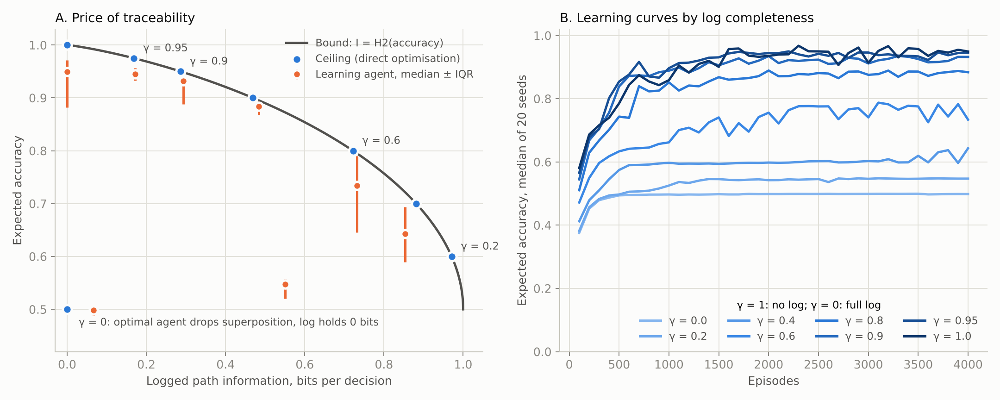
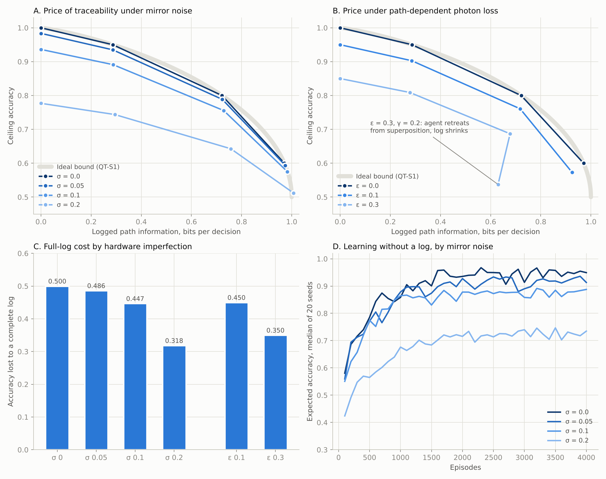

# Price of traceability

What happens to a quantum learning agent when you keep a record of how it decides?

This repository holds two small simulation studies of a photonic learning agent in the spirit of Flamini et al. (New J. Phys. 22, 045002, 2020). The agent deliberates by sending one photon through a mesh of tunable beamsplitters; the detected output mode is its action. We add a log that records which internal path the photon took, with adjustable completeness, and measure how much task performance the agent loses per bit of logged deliberation.

The trade-off itself follows from the Englert duality relation (D² + V² ≤ 1): recording the path suppresses interference. The studies ask what that means for a reward-driven agent, and how it behaves on imperfect hardware.

## Results in brief

**QT-S1, ideal optics** ([report](reports/QT-S1_report.md))

- Partial logs are cheap: 0.29 bit of path log per decision costs 5 accuracy points.
- The last bits are expensive: going from 0.47 to 0.97 bit costs 30 points.
- Under a complete log the optimal agent drops superposition entirely and deliberates classically.
- Learning agents drift toward classical deliberation under a heavy log (exploratory).



**QT-S2, mirror noise and photon loss** ([report](reports/QT-S2_report.md))

- The shape of the price survives mirror noise: the last bits cost about 4.6 times more per bit than the first ones at every noise level tested.
- Imperfect hardware is cheaper to audit in absolute terms: at 0.2 rad of noise a complete log costs 0.32 accuracy instead of 0.50.
- With 30% photon loss on the phase-carrying paths, the agent retreats from superposition already under a partial log.
- Learning tolerates mirror noise up to 0.2 rad.



## Hypothesis verdicts

| Study | Hypothesis | Verdict |
|---|---|---|
| QT-S1 | H1 ceiling = (1 + gamma)/2 | supported |
| QT-S1 | H2 logged bits = H2(accuracy) at the optimum | rejected as stated: holds for every gamma > 0, fails at gamma = 0 (degenerate optimum) |
| QT-S1 | H3 learning slows as the log grows | formally supported, weak (rho = -0.19) |
| QT-S2 | H1 non-linear price survives noise and loss | supported on 5 of 6 settings, undefined on 1 |
| QT-S2 | H2 imperfect hardware lowers the full-log cost | supported |
| QT-S2 | H3 Flamini replication: noise tolerated by learning | rejected by 0.001; tolerance replicated in substance, no benefit observed |

## Read this before citing

- **Toy model.** 4 modes, one photon, uniform which-path marker overlaps. The task bit that the log destroys is delivered only as a phase by construction, so the price applies to task information carried by interference. No claim of quantum advantage over classical agents in general.
- **Protocols.** Each protocol in `protocols/` was written and fixed before its main run, within the same working session. It carries no external timestamp, so treat it as a protocol fixed before the run rather than an independently registered pre-registration.
- **Tooling.** The studies were designed, coded and analysed with Claude (Opus 5.5, Anthropic) under the direction of Julia Ryzhkova.
- **Hardware realism.** Noise of 0.2 rad is large compared with phase errors typical for integrated photonics; numbers describe the model and carry no claim about a specific chip.

## How to run

Python 3.10+, numpy, matplotlib (`pip install -r requirements.txt`). Scripts read and write in the current folder.

```bash
# QT-S1 (about 4 min pilot + 9 min main on one core)
cd results/QT-S1
python ../../src/qt_s1_sim.py pilot
python ../../src/qt_s1_sim.py main 0.02
python ../../src/qt_s1_analyze.py

# QT-S2 (about 18 min on two cores)
cd ../QT-S2
python ../../src/qt_s2_sim.py
python ../../src/qt_s2_analyze.py
```

All randomness is seeded; with the same numpy version the results files are reproduced.

## Layout

```
protocols/   study protocols, fixed before each main run
src/         simulation and analysis code (QT-S2 reuses the QT-S1 model)
results/     raw results, learning curves, summaries, hypothesis tests, figures, run logs
reports/     results and interpretation for each study
```

## Related work

- F. Flamini et al., Photonic architecture for reinforcement learning, New J. Phys. 22, 045002 (2020).
- B.-G. Englert, Fringe visibility and which-way information: an inequality, Phys. Rev. Lett. 77, 2154 (1996).
- H. J. Briegel, G. De las Cuevas, Projective simulation for artificial intelligence, Sci. Rep. 2, 400 (2012).
- H. J. Briegel, T. Müller, A chance for attributable agency, Minds and Machines 25, 261 (2015).
- H.-Y. Huang et al., Quantum advantage in learning from experiments, Science 376, 1182 (2022).

## Feedback welcome

Physicists especially: is the retreat from superposition under path-dependent loss already known from the which-path literature, and what would break first on a real integrated chip? Please open an issue.

## Citation and license

Cite via `CITATION.cff`. Code: MIT License. Protocols, reports and figures: CC BY 4.0.
